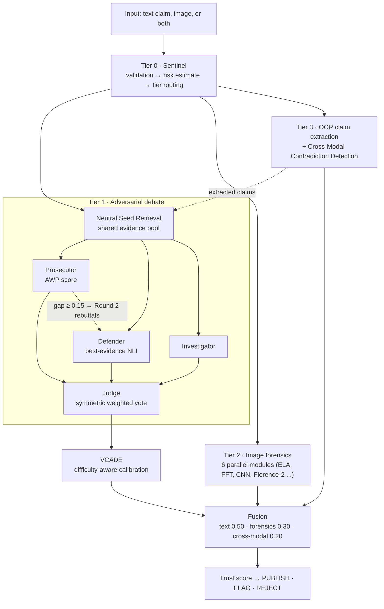

# AMADA — Adversarial Multi-Agent Debate Architecture

**Multimodal hallucination & misinformation detection with deepfake forensics and difficulty-adaptive confidence calibration**

📄 **Published at IEEE ISAIA 2026**, the IEEE International Conference on Intelligent Systems and Interdisciplinary
Applications, Montclair State University, NJ, USA (Oct 2026) · **Author:** Retheshna Posina (sole author)


---

## The problem

Generative AI now produces four distinct kinds of misinformation at once:

1. **Textual hallucination:** fluent but false claims from large language models
2. **Statistical manipulation:** correct numbers (counts, rates, dates) swapped for plausible fakes
3. **Synthetic imagery:** AI-generated or edited photos that pass casual inspection
4. **Cross-modal contradiction:** a real photo paired with a caption that describes something else

Most fact-verification pipelines handle only one of these, and they report confidence scores that are poorly calibrated to the evidence they actually see.

## What AMADA does

AMADA verifies **text, images, or both** through a four-tier cascade. Specialist agents **debate** each claim over a shared
evidence pool, a **Judge** decides, and a calibrator converts the verdict into a **trust score** with a policy decision:
**PUBLISH · FLAG · REJECT**.


*A real photo of a suitcase submitted with the caption "book on floor". The cross-modal check catches the contradiction and rejects it (trust 25%).*

## Architecture



### The three algorithms

| Algorithm | What it does |
|---|---|
| **AWP**: Adversarial Weight Perturbation scoring | Scores a claim by how much of its evidential support survives against its strongest adversarial variant across 5 channels: citation existence, entity substitution, numeric scaling, temporal staleness, and negation. `AWP = s₀ / (s₀ + sₑ)`. Decision thresholds are **learned from data**, not fixed. |
| **VCADE**: Versatile Calibration and Difficulty Estimation | Re-scales confidence along 5 difficulty axes: retrieval sparsity, evidence dispersion, adversarial pressure, entity ambiguity, and temporal sensitivity. It hands off to isotonic regression once labeled audit data accumulates. |
| **CMCD**: Cross-Modal Contradiction Detection | Compares Florence-2 visual attributes (color, object presence, counts) with the entities in the caption, on top of a CLIP image–text similarity baseline. |

## Results (all measured on the live pipeline, held-out data)

**Text verification on FEVER (1,000 held-out claims)**

| Configuration | Accuracy | Macro-F1 |
|---|---|---|
| As submitted | 39.9% | 0.369 |
| **Calibrated thresholds + balanced debate** | **44.4%** | **0.435 (+18%)** |

**Confidence calibration (500 held-out claims, 15-bin ECE, lower is better)**

| Method | ECE |
|---|---|
| Uncalibrated trust | 0.464 |
| **VCADE (cold start, no labels needed)** | **0.374 (−19.5%)** |
| Platt scaling (fitted on labels) | 0.033 |
| Isotonic regression (fitted on labels) | 0.020 |

**Multimodal verification on Fakeddit (500 balanced image–caption pairs)**: ranking AUC **0.637**

| Operating point | Accuracy | Precision | Recall |
|---|---|---|---|
| High-sensitivity screening (for human review) | 51.4% | 0.507 | **0.956** |
| High-precision (calibrated on a disjoint split) | 63.2% | **0.906** | 0.246 |

**Latency (warm start, Apple silicon, 16 GB RAM)**: risk routing 0.07 ms · text verification 3.6 s (p95 5.9 s) ·
multimodal 10.6 s (p95 17.1 s). Live evidence retrieval dominates. The current design suits batch and asynchronous auditing.

## Key findings

1. **Calibrate decision thresholds to the live score distribution.** Cross-encoder NLI probabilities are bimodal, so the AWP score
   clustered near zero (median 0.042). That's an order of magnitude below the original fixed boundary. Learning thresholds from data
   raised macro-F1 from 0.347 to 0.429 on its own.
2. **Measure whether multi-agent debate is really multi-agent.** In the original protocol, one agent's vote decided **98.5%**
   of verdicts. Rebalancing confidence and vote weights made every agent contribute. The debate now revises the single-agent
   decision on held-out claims and lifts accuracy from 41.6% to 44.4%.
3. **Retrieval is the binding constraint.** Downstream reasoning extracts nearly all the signal available in the evidence.
   A claim-conditioned dense retriever is the clearest path to higher accuracy.

## Engineering

- **FastAPI** service with **Pydantic** typed schemas and per-claim JSONL audit logs
- **Prompt-injection resistance:** the Judge receives only typed message objects, never raw user content
- **103-case pytest suite** covering AWP, VCADE, CMCD, debate orchestration, forensics, security boundaries, and threshold learning
- Models: DeBERTa-v3 cross-encoder (NLI), CLIP ViT-L/14, Florence-2, BLIP, all-MiniLM-L6-v2 (about 4 GB in total)

**Tech stack:** Python · asyncio · PyTorch · Hugging Face Transformers · sentence-transformers · scikit-learn · OpenCV · FastAPI · pytest

## Roadmap

- [ ] Claim-conditioned dense retrieval (BM25 + dense + reranker) to lift FEVER accuracy
- [ ] Evaluation on health-claim fact-checking benchmarks
- [ ] Expose AMADA as an MCP tool, so any AI agent can fact-check through it
- [ ] Extended journal version

## Code availability

The source code and evaluation artifacts are being prepared for public release alongside the extended journal
version. Until then, they're available on request to reviewers and hiring teams.
Contact me on [LinkedIn](https://www.linkedin.com/in/retheshnaposina/).

## Citation

```bibtex
@inproceedings{posina2026amada,
  title     = {AMADA: An Adversarial Multi-Agent Debate Architecture for Multimodal Misinformation Detection
               with Deepfake Forensics and Difficulty-Adaptive Confidence Calibration},
  author    = {Posina, Retheshna},
  booktitle = {2026 IEEE International Conference on Intelligent Systems and Interdisciplinary Applications (ISAIA)},
  address   = {Montclair, NJ, USA},
  year      = {2026},
  publisher = {IEEE}
}
```

## Acknowledgment

Developed as an M.Tech (Artificial Intelligence) final-year project at SRM Institute of Science and Technology,
under the supervision of Dr. M. Prakash.
